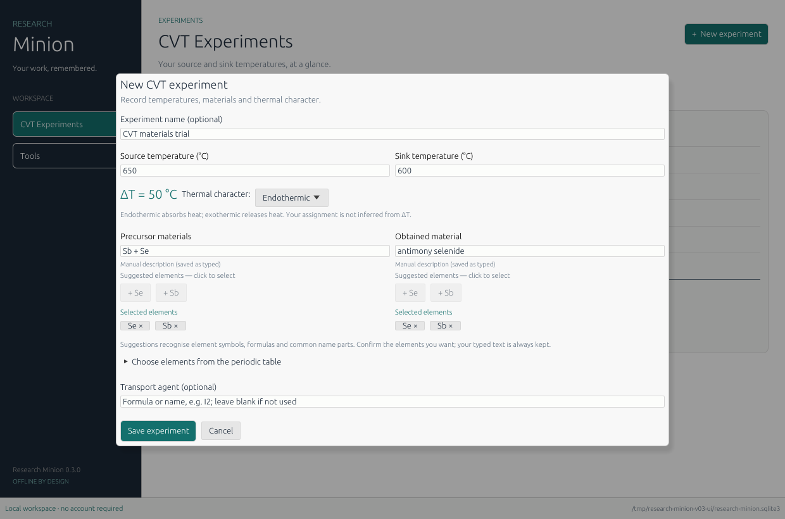
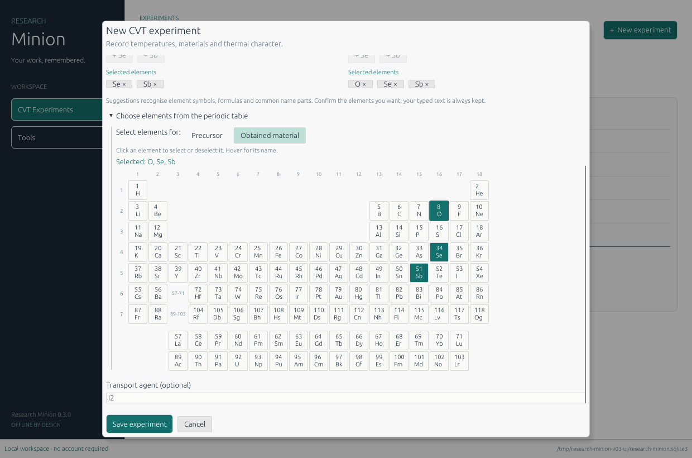

# Research Minion

An offline Windows research workspace built with Rust, egui/eframe, and SQLite.
Version **0.3** adds material selection, thermal character, and experiment-linked logs.

## Download and try it

For **Windows 10/11, 64-bit**:

- **[Download Research Minion.exe](https://github.com/vermasaksham/Research-Minion/raw/refs/heads/main/downloads/Research-Minion-0.3.0-windows-x64.exe)**
- [Download the portable ZIP with instructions](https://github.com/vermasaksham/Research-Minion/raw/refs/heads/main/downloads/Research-Minion-0.3.0-windows-x64-preview.zip)
- [Download checksums](downloads/SHA256SUMS.txt)

Download the executable and double-click it. If you choose the ZIP, extract it
first and open `research-minion.exe`. Using the app does not require installing
Rust, .NET, Python, SQLite, or a web runtime.

1. The app opens in **CVT Experiments**. Click **+ New experiment**.
2. Enter source and sink temperatures, for example **650 °C** and **600 °C**.
   The form previews **ΔT = Source − Sink = 50 °C**.
3. Choose **Endothermic**, **Exothermic**, or **Not specified**. This is your
   scientific assignment; the application does not infer enthalpy from ΔT.
4. Enter precursor and obtained-material descriptions. Try `Sb2Se3`, `Sb₂Se₃`,
   or `antimony selenide`. Click suggested element chips or **Add suggested** to
   confirm those elements. Your typed text is kept whether or not you select chips.
5. Alternatively, expand **Choose elements from the periodic table**, select
   **Precursor** or **Obtained material**, and click element buttons. Each set is
   independent. Click a selected element again to remove it.
6. Add a **Transport agent** if relevant, or leave it blank. Click **Save experiment**.
7. **Click the experiment bar or its name to open its log.** Add a title, event
   date (`YYYY-MM-DD`), and notes; click **Save entry** or press **Ctrl+S**.
8. Close and reopen the app to return to your saved experiments and logs.

The sidebar contains **CVT Experiments** and **Tools**. There is no separate
Logbook tab. Earlier, unlinked project notes remain accessible through
**Previous project logs** on the Experiments page when such notes exist.

This is an early preview. Thirty automated tests and Linux interface checks pass.
The executable was cross-compiled for Windows; Windows execution remains
unverified. Preview binaries are hosted directly in this repository, rather than
as GitHub Release assets, because release-API access is unavailable here.







Screenshots use disposable example records; new workspaces start empty.

## What works

- All saved CVT experiments appear on a shared temperature axis in °C. Horizontal
  position and joining lines are schematic, not measured distances or profiles.
- Source/sink values and signed ΔT support equal and reversed temperatures.
  Non-finite values and temperatures below absolute zero are rejected.
- Optional researcher-assigned thermal character, precursor/product descriptions,
  independent confirmed element sets, and optional transport-agent text are saved.
- A complete 118-element selector and local formula/name suggestions work offline.
- Each experiment has its own persistent log with dated entries, editing, and search.
- Event dates are separate from UTC creation/edit timestamps. Stable IDs and
  revision checks protect against stale entry overwrites from another instance.
- Normal navigation/close requests protect unsaved forms and notes.

There are no accounts, telemetry, AI calls, hosted services, or runtime downloads.
SQLite and interface fonts are bundled. Initial builds require Internet access to
fetch the pinned Rust toolchain and dependencies; using the executable does not.

## Scientific meaning of the material suggestions

Formulas are case-sensitive: **Co** is cobalt; **CO** contains carbon and oxygen.
The helper recognises element symbols, Unicode subscripts, balanced groups, and
common name parts such as `selenide`, `oxide`, and `chloride`. Element-name prefix
completion and a small explicit common-name vocabulary are included.

This is not a comprehensive chemical-name resolver, a formula/stoichiometry
validator, or a reaction/product predictor. Unknown text is kept, with the periodic
table available as a fallback. Suggested elements are not added to your confirmed
selection until you choose them. See [chemistry conventions](docs/CHEMISTRY.md).

## Where your work lives

The default Windows folder is `%LOCALAPPDATA%\ResearchMinion`, containing
`research-minion.sqlite3`. The full path appears in the status bar. On Linux it
uses `$XDG_DATA_HOME/ResearchMinion`, normally `~/.local/share/ResearchMinion`.
You can choose a different local folder:

```powershell
.\research-minion.exe --data-dir "C:\Research\My logbook"
```

Replacing the executable does not require deleting this data folder. Version 0.3
upgrades older databases to schema 3, preserving experiments, projects, and notes.
Older CVT records receive empty independent logs and unspecified material/thermal
fields. Previous project notes are not assigned to experiments by guessing from
names; access them through **Previous project logs**. Versions 0.1/0.2 cannot open
an upgraded database.

Save is explicit; unsaved text does not survive a crash or forced shutdown.
Revision numbers detect conflicting entry edits and are not edit history. The
database is local and unencrypted, without cloud sync. Avoid network shares and
synchronised folders for an open database.

Automatic backup/restore is not implemented. Save and close **all** app instances,
then copy the entire data folder to a separate location. Keep any `-wal` and
`-shm` files with it if present. Restore with the app closed, preferably into a
separate folder opened using `--data-dir`.

## Build and develop

For Windows, install [Rust](https://www.rust-lang.org/tools/install) with the MSVC
toolchain and Visual Studio Build Tools including **Desktop development with C++**
and a Windows SDK. The app targets x64 Windows 10/11 with an OpenGL-capable driver.
The toolchain is pinned in `rust-toolchain.toml`; dependencies are in `Cargo.lock`.

```sh
cargo run --locked
cargo fmt --all -- --check
cargo clippy --locked --all-targets -- -D warnings
cargo test --locked
cargo build --locked
```

To build a portable Windows release ZIP:

```powershell
.\scripts\build-windows.ps1
```

The script runs tests and builds under `target/x86_64-pc-windows-msvc/release/`;
the ZIP is placed in `target/packages/`. It is a portable package, not an installer.
The native Windows script/CI result is separate from the cross-compiled preview;
no Windows execution result is claimed here.

For headless storage/chemistry development, use
`cargo test --locked --no-default-features`. After dependencies are downloaded,
add `--offline`. On a Linux desktop, `cargo run --locked` uses X11. Typical runtime
libraries are `libx11-6`, `libxkbcommon-x11-0`, `libgl1`, and `libegl1`. A headless
cloud machine needs a virtual display only for interface checks.

## Scope and next decisions

Experiment metadata can be entered when adding an experiment; editing/deleting
that metadata is not implemented yet. Log entries can be edited. Tasks, samples,
attachments, autosave/recovery, edit history, readable export, templates, automatic
backups, and richer scientific calculations remain future increments.

**Peak Explorer is not integrated.** Tools marks it as planned. Its original source
and scientific reference data are not in this checkout; none have been recreated
from the handover. Integration first needs that source and its existing checks.

See [design and roadmap](docs/DESIGN.md) and [validation evidence](docs/VALIDATION.md).
