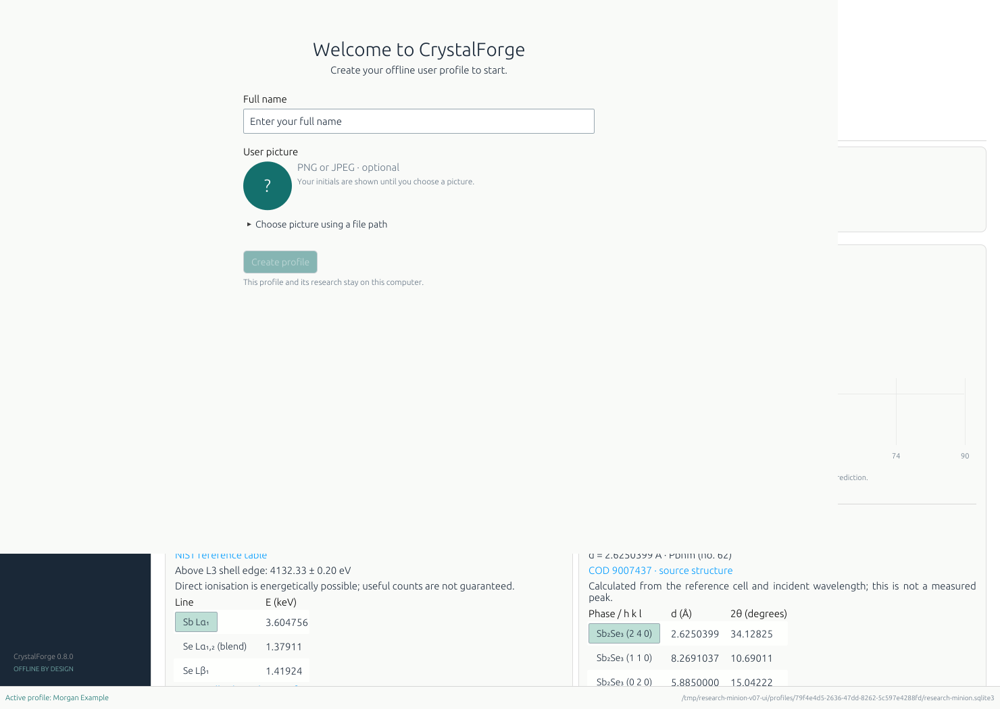
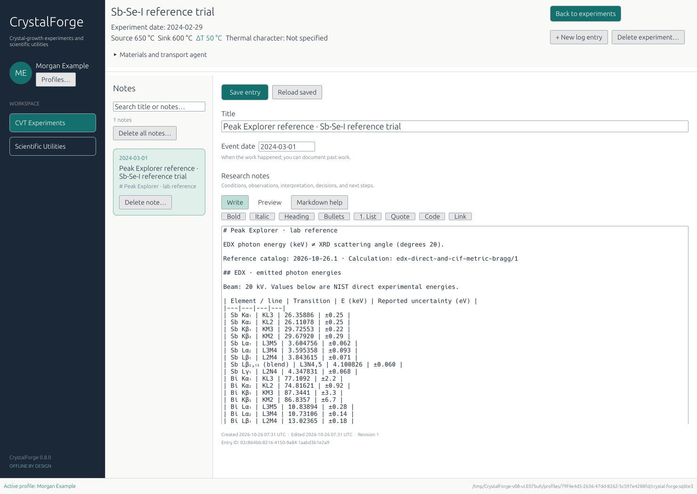
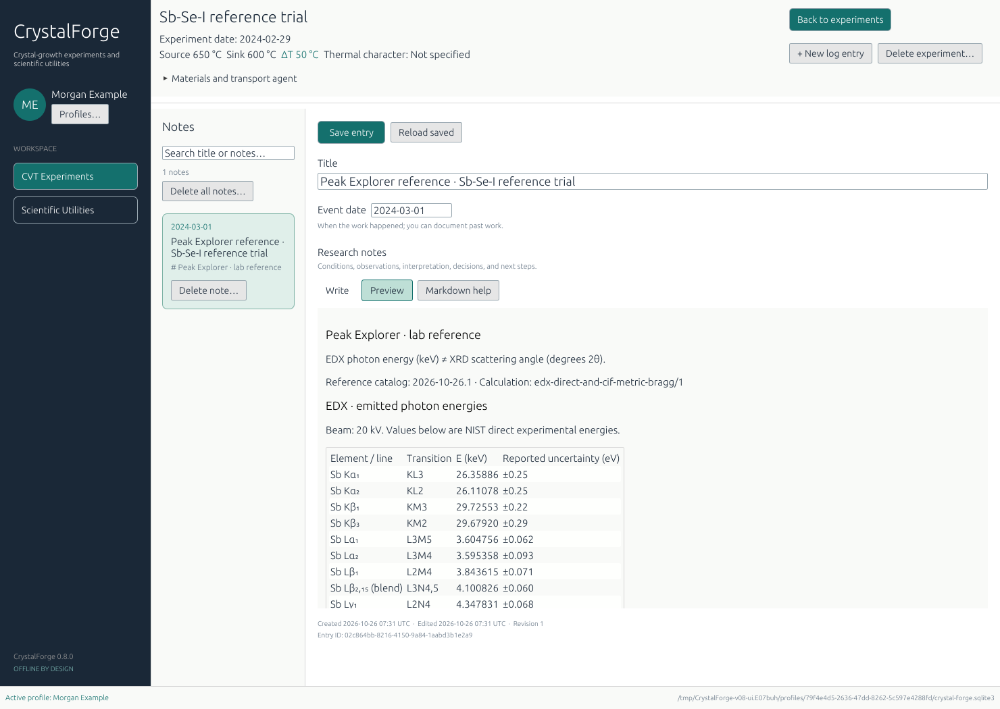
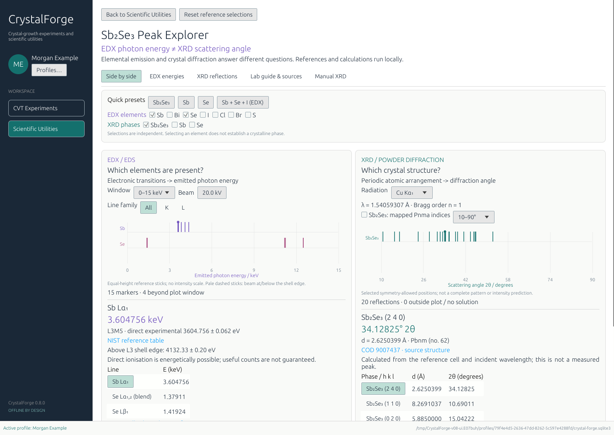

# CrystalForge

**Crystal-growth experiments and scientific utilities.**

An offline Windows research workspace built with Rust, egui/eframe, and SQLite.
Version **0.8** introduces the CrystalForge name and keeps the interactive Sb₂Se₃ Peak Explorer: separate EDX energy
and XRD diffraction views, source inspection, crystal-setting mapping and local
reference snapshots. Markdown notes and separate offline user profiles remain available.

## Download and try it

For **Windows 10/11, 64-bit**:

- **[Download CrystalForge.exe](https://github.com/vermasaksham/Research-Minion/raw/refs/heads/main/downloads/CrystalForge-0.8.0-windows-x64.exe)**
- [Download the portable ZIP with instructions](https://github.com/vermasaksham/Research-Minion/raw/refs/heads/main/downloads/CrystalForge-0.8.0-windows-x64-preview.zip)
- [Download checksums](downloads/SHA256SUMS.txt)

Close older versions, download the executable and double-click it. If you choose the ZIP, extract it
first and open `crystal-forge.exe`. Using the app does not require installing
Rust, .NET, Python, SQLite, or a web runtime.

On first launch, enter your **Full name** and choose a **User picture** (optional).
Windows offers a native **Choose picture…** dialog; you can also drop a PNG/JPEG
onto the profile form or use its file-path option. Pictures are copied into the
profile, so the original file is no longer required. If you skip the picture,
your initials are shown.

The first profile takes ownership of earlier experiments and notes in this data
folder. Later profiles start empty. Use **Profiles…** under your sidebar name to
create or switch users, or edit your name/picture. Switching protects unsaved notes.

1. After profile setup, the app opens in **CVT Experiments**. Click **+ New experiment**.
2. In **Conditions**, enter the experiment date (`YYYY-MM-DD`; blank if unknown), a name if useful,
   and source and sink temperatures, for example **650 °C** and **600 °C**.
   The form previews **ΔT = Source − Sink = 50 °C**.
3. Choose **Endothermic**, **Exothermic**, or **Not specified**. This is your
   scientific assignment; the application does not infer enthalpy from ΔT.
4. Open **Materials & transport agent** for the optional material fields.
   Enter precursor and obtained-material descriptions. Try `Sb2Se3`, `Sb₂Se₃`,
   or `antimony selenide`. Click suggested element chips or **Add all** to
   confirm those elements. Your typed text is kept whether or not you select chips.
5. Alternatively, expand **Choose from the periodic table**, select
   **Precursor** or **Obtained material**, and click element buttons. Each set is
   independent. Click a selected element again to remove it.
6. Add a **Transport agent** if relevant, or leave it blank. Click **Save experiment**.
7. **Click the experiment bar or its name to open its log.** Add a title, event
   date (`YYYY-MM-DD`), and notes. Use **Write** for Markdown source and **Preview**
   to see the current draft rendered. Select text and use the formatting toolbar,
   or type Markdown directly. Click **Save entry** or press **Ctrl+S**.
8. Use **Back to experiments** at the top of the log to return to the main view.
9. Each saved note has its own **Delete note…** button in the **Notes** list;
   confirmation names the chosen note, and other notes remain. **Delete all notes…** clears the whole log.
   **Delete experiment…** hides an experiment together with its log.
   **Recently deleted** on the overview lets you restore saved records.
10. Open **Scientific Utilities → Peak Explorer**. Select EDX elements and XRD
    phases independently. Click a marker or table row to inspect its cited reference.
    Compare Cu/Co radiation, custom wavelength and Pbnm/Pnma settings. Expand
    **Save / export reference snapshot** to save an analysis to an experiment log
    or export JSON into the active profile. **Manual XRD** retains the earlier calculator.
11. Close and reopen the app to return to your saved experiments and logs.

The sidebar contains **CVT Experiments** and **Scientific Utilities**. There is no separate
Logbook tab. Earlier, unlinked project notes remain accessible through
**Previous project logs** on the Experiments page when such notes exist.

This is an early preview. Seventy-one automated tests and Linux interface checks pass.
The executable was cross-compiled for Windows; Windows execution remains
unverified. Preview binaries are hosted directly in this repository, rather than
as GitHub Release assets, because release-API access is unavailable here.










Screenshots use synthetic profiles, a synthetic picture, and disposable records.
New profiles start empty unless the first profile adopts an earlier workspace.

## What works

- Offline profiles ask for a full name and optional PNG/JPEG picture. The active
  user appears above Workspace in the sidebar. Profile pictures are normalised
  locally, including JPEG orientation, and remain available after the source file
  is removed.
- Each profile opens a separate research database: experiments, project notes,
  searches, saved analyses, and Recently deleted belong to that profile.
- The experiment name, date, temperatures and materials sit on the left of the
  header; Back, New log entry and Delete experiment sit at the upper right.
  Below it, the note list and editor share
  the available width. Expanded metadata scrolls within the header. Individual
  deletion remains on each note card; the duplicate editor delete button is removed.

- Research notes support Markdown headings, bold/italic/strikethrough, lists,
  quotes, links, tables, task markers and code blocks. Write/Preview switches
  preserve the draft; saving retains the exact source. Toolbar formatting supports
  Unicode selections and undo/redo. See the [Markdown guide](docs/MARKDOWN.md).

- All saved CVT experiments appear on a shared temperature axis in °C. Horizontal
  position and joining lines are schematic, not measured distances or profiles.
- Source/sink values and signed ΔT support equal and reversed temperatures.
  Non-finite values and temperatures below absolute zero are rejected.
- Optional researcher-assigned thermal character, precursor/product descriptions,
  independent confirmed element sets, and optional transport-agent text are saved.
- A complete 118-element selector and local formula/name suggestions work offline.
- Each experiment has its own persistent log with dated entries, editing, and search.
- Recorded experiments show a researcher-entered experiment date. Older records
  show Not specified; recording time stays separate and is available on hover.
- Experiments, whole logs, and individual log entries have confirmed, recoverable
  deletion. Restore experiments with their logs, or restore deleted entries.
- Peak Explorer separates EDX energies (keV) from XRD angles (degrees 2θ).
  Its 46 selected direct experimental NIST markers cover **Sb, Bi, Se, I, Cl, Br
  and S**, with uncertainties, blends and source links. Beam/edge checks show only
  a necessary excitation condition, not useful-count predictions.
- XRD includes **Sb₂Se₃, elemental Sb and trigonal Se**: three cited CIFs and 48
  selected symmetry-allowed reflections. Cu/Co/custom wavelengths and explicit
  Sb₂Se₃ Pbnm/Pnma mapping work offline. This is not a complete powder pattern or
  automatic phase identification. **SbSeI and SbI₃ XRD references are not bundled**;
  iodine EDX lines cannot substitute for their diffraction patterns.
- Local JSON exports and dated analysis notes retain units, sources, uncertainties,
  cell/settings, inputs and interpretation. The manual orthorhombic and Bragg
  calculators remain available. See the [Peak Explorer guide](docs/PEAK-EXPLORER.md).
- Event dates are separate from UTC creation/edit timestamps. Stable IDs and
  revision checks protect against stale entry overwrites from another instance.
- Normal navigation/close requests protect unsaved forms and notes. Deleting a
  different saved note preserves the current editor draft, including a new unsaved note.

Profiles are local identities, without passwords or a hosted account service.
There is no telemetry, and the app makes no AI calls or runtime downloads.
SQLite and interface fonts are bundled. Initial builds require Internet access to
fetch the pinned Rust toolchain and dependencies; using the executable does not.

## Scientific meaning of the material suggestions

Formulas are case-sensitive: **Co** is cobalt; **CO** contains carbon and oxygen.
The helper recognises element symbols, Unicode subscripts, balanced groups, and
common name parts such as `selenide`, `oxide`, and `chloride`. Element-name prefix
completion and a small explicit common-name vocabulary are included.

This is not a comprehensive chemical-name resolver, a formula/stoichiometry
validator, or a reaction/product predictor. Unknown text is kept, with the periodic
table available as a fallback. Suggested elements are not added to your confirmed
selection until you choose them. See [chemistry conventions](docs/CHEMISTRY.md).

## Where your work lives

The default Windows folder is `%LOCALAPPDATA%\CrystalForge`. On Linux it uses
`$XDG_DATA_HOME/CrystalForge`, normally `~/.local/share/CrystalForge`.

- `profiles.sqlite3` contains profile identities, copied pictures and the last
  active profile.
- New profiles use `profiles/<profile UUID>/crystal-forge.sqlite3` for their
  research records.
- If an earlier installation already has a `research-minion.sqlite3` database or
  `%LOCALAPPDATA%\ResearchMinion` data folder, CrystalForge opens it in place so
  existing profiles, experiments and notes remain available. The first profile
  owns it in its original location. It is not moved or copied;
  existing notes, IDs, timestamps and deletion states are preserved. Later users
  receive independent databases.

The active database path appears in the status bar. To choose another complete
local data folder:

```powershell
.\crystal-forge.exe --data-dir "C:\Research\My logbook"
```

Replacing the executable does not require deleting the data folder. Version 0.5
keeps research schema 4 and adds a separate profile catalog (schema 1). Older
research databases still upgrade through the retained migrations. Use version
0.5 or later to select profiles; earlier application versions do not understand
the profile catalog or find new profile databases automatically.

Older experiment dates remain unknown. Previous project notes are not assigned
to experiments by guessing names; find them through **Previous project logs**
inside their owner's profile. Profiles group data into separate workspaces; they
are not password protection or encryption.

Save is explicit; unsaved text does not survive a crash or forced shutdown.
Revision numbers detect conflicting entry edits and are not edit history. The
database is local and unencrypted, without cloud sync. Avoid network shares and
synchronised folders for an open database.

Deletion retains saved records in the database, without automatic expiry or a
permanent-purge command. Restoring an experiment does not restore entries that
were individually deleted beforehand. Unsaved edits discarded during deletion
are not recoverable. This is separate from backup and edit history.

Automatic backup/restore is not implemented. Save and close **all** app instances,
then copy the **entire data folder**, including `profiles.sqlite3`, all profile
subfolders, any earlier root database, and any `-wal`/`-shm` files. A copy of only
one research database does not include all profiles or profile pictures. Restore with the app closed, preferably into a
separate folder opened using `--data-dir`.

## Build and develop

For Windows, install [Rust](https://www.rust-lang.org/tools/install) with the MSVC
toolchain and Visual Studio Build Tools including **Desktop development with C++**
and a Windows SDK. The app targets x64 Windows 10/11 with an OpenGL-capable driver.
The toolchain is pinned in `rust-toolchain.toml`; dependencies are in `Cargo.lock`.

```sh
cargo run --locked
cargo fmt --all -- --check
cargo clippy --locked --all-targets -- -D warnings
cargo test --locked
cargo build --locked
```

To build a portable Windows release ZIP:

```powershell
.\scripts\build-windows.ps1
```

The script runs tests and builds under `target/x86_64-pc-windows-msvc/release/`;
the ZIP is placed in `target/packages/`. It is a portable package, not an installer.
The native Windows script/CI result is separate from the cross-compiled preview;
no Windows execution result is claimed here.

For headless storage/chemistry/calculation development, use
`cargo test --locked --no-default-features`. After dependencies are downloaded,
add `--offline`. On a Linux desktop, `cargo run --locked` uses X11. Typical runtime
libraries are `libx11-6`, `libxkbcommon-x11-0`, `libgl1`, and `libegl1`. A headless
cloud machine needs a virtual display only for interface checks.

## Scope and next decisions

Experiment metadata can be entered when adding an experiment; editing that
metadata is not implemented yet. Log entries can be edited. Tasks, samples,
attachments, autosave/recovery, edit history, readable export, templates, and
automatic backups remain future increments.

**Peak Explorer is an initial XRD calculator, not the original Sb₂Se₃ tool's
complete integration.** The original source/CIFs/reference data are absent from
this checkout. This build has no Sb/Se EDX marker catalog, material reference
cells, selected symmetry-allowed reflection catalog, or Pbnm/Pnma conversion.
It uses your entered orthorhombic axes exactly as supplied, without symmetry
filtering, intensities, phase fractions, or phase identification. Do not use it
for non-orthorhombic cells. See [Peak Explorer scope and formulas](docs/PEAK-EXPLORER.md).

See [design and roadmap](docs/DESIGN.md) and [validation evidence](docs/VALIDATION.md).
