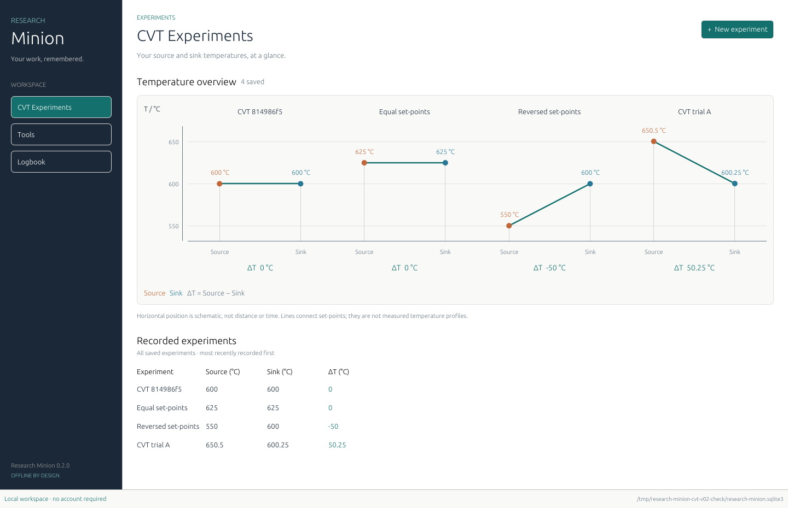

# Research Minion

An offline desktop research logbook, built with Rust, egui/eframe, and SQLite.
Version 0.2 adds the CVT experiment overview to the first logbook milestone.

## Download and try it

For **Windows 10/11, 64-bit**:

- **[Download Research Minion.exe](https://github.com/vermasaksham/Research-Minion/raw/refs/heads/main/downloads/Research-Minion-0.2.0-windows-x64.exe)**
- [Download the portable ZIP with instructions](https://github.com/vermasaksham/Research-Minion/raw/refs/heads/main/downloads/Research-Minion-0.2.0-windows-x64-preview.zip)
- [Download checksums](downloads/SHA256SUMS.txt)

Download the executable to your PC and double-click it. If you choose the ZIP,
extract it first and open `research-minion.exe` inside the extracted folder.
Using the application does not require installing Rust, .NET, Python, or SQLite.

1. The application opens in **CVT Experiments**.
2. Click **+ New experiment**.
3. Try source **650 °C** and sink **600 °C**. The live difference is **50 °C**.
4. Click **Save experiment**, close the app, and reopen to see the saved record.
5. Choose **Logbook** in the sidebar for project notes, or **Tools** for the
   planned Peak Explorer.

This is an early preview. Twenty automated tests and Linux interface checks pass;
the executable was cross-compiled for Windows, but Windows execution has not yet
been verified. These versioned preview files are hosted directly in the
repository; they are not GitHub Release assets.



The screenshot uses disposable example records. New workspaces start empty.

## What works

- Open directly into **CVT Experiments**, with a left sidebar for **Tools** and
  the existing **Logbook**.
- Add experiments with **+ New experiment**, entering source and sink temperatures
  in °C. The form calculates **ΔT = Source − Sink** live; a name is optional.
- Compare saved experiments on a shared temperature axis. The horizontal axis
  is schematic, not distance or time; connecting lines are not measured profiles.
  Scroll horizontally for more experiments or vertically for the full record list.
- Save experiments locally and see them again after reopening the app. Equal or
  reversed temperatures are allowed, giving zero or negative ΔT. Invalid,
  non-finite, and below-absolute-zero inputs are rejected.
- Create projects with a name and optional description.
- Create, reopen, and edit plain-text logbook entries.
- Give an entry an **event date** independent of when it was written.
- Save explicitly with **Save entry** or **Ctrl+S**.
- Search titles and notes within the selected project; entries sort by event date.
- Keep, save, or discard unsaved edits when navigating or closing normally.
- Preserve stable IDs and UTC creation/edit timestamps; reject stale overwrites
  from another application instance without clearing your draft.

There are no accounts, hosted services, telemetry, AI calls, or runtime downloads.
SQLite and interface fonts are bundled into the executable. Building initially
requires Internet access to fetch the Rust toolchain and dependencies; using the
built application does not.

## Build and run from source on Windows

Target: Windows 10/11, x64, with a working graphics driver supporting OpenGL 2.0
or later. Windows UI execution has **not** been verified in this Linux workspace.

1. Install [Rust](https://www.rust-lang.org/tools/install), choosing the MSVC
   toolchain, and Visual Studio Build Tools with **Desktop development with C++**
   and a Windows SDK. A separate .NET or WebView2 installation is not needed.
2. Open a developer PowerShell in this repository and run:

   ```powershell
   cargo run --locked
   ```

3. The app opens in **CVT Experiments**. Click **+ New experiment**, enter source
   and sink temperatures, check ΔT, and click **Save experiment**. Close and reopen
   the app to see the saved experiment.
4. For research notes, choose **Logbook** in the sidebar, create a project, then
   write and save an entry. Entry event dates use `YYYY-MM-DD`.

To build a portable release ZIP on Windows:

```powershell
.\scripts\build-windows.ps1
```

The script runs the tests and builds an x64 executable in
`target/x86_64-pc-windows-msvc/release/`. The ZIP is placed in `target/packages/`.
Extract it before running `research-minion.exe`. This is a portable application
package, not an installer. The Windows CI job also builds and uploads this ZIP;
that job has not been executed from this session.

## Where your work lives

On Windows the default folder is `%LOCALAPPDATA%\ResearchMinion`, containing
`research-minion.sqlite3`. The full database path is shown in the status bar.
On Linux the equivalent is `$XDG_DATA_HOME/ResearchMinion` (normally
`~/.local/share/ResearchMinion`). You can choose a different local folder:

```powershell
cargo run --locked -- --data-dir "C:\Research\My logbook"
# Or, after building:
.\research-minion.exe --data-dir "C:\Research\My logbook"
```

Experiments and entries are saved only when you explicitly save. Unsaved text does not survive a
crash or forced shutdown. The revision number detects conflicting edits; it is
**not** edit history. Data is ordinary local SQLite, without encryption or cloud
sync. Avoid using a network share or a synchronised folder for an open database.

Version 0.2 upgrades an existing version 0.1 database by adding a CVT experiments
table, preserving projects and entries. Version 0.1 cannot open the upgraded
database. Use the newer executable to continue working with it.

Automatic backup/restore is not implemented. For a manual safety copy, save and
close **all** Research Minion instances, then copy the entire data folder to a
separate location. Keep any `-wal` and `-shm` files with the database if present.
Restore only while the app is closed, preferably into a separate folder opened
with `--data-dir`. Do not copy only the database while it is open.

## Develop and test

The Rust toolchain is pinned in `rust-toolchain.toml`; dependencies are pinned in
`Cargo.lock`. A C compiler is needed because the SQLite library is built locally.

```sh
cargo fmt --all -- --check
cargo clippy --locked --all-targets -- -D warnings
cargo test --locked
cargo build --locked
```

For storage/editor development without a graphical display or desktop build:

```sh
cargo test --locked --no-default-features
```

After dependencies have been downloaded, these commands can use `--offline`.
On a Linux desktop, `cargo run --locked` opens the same interface using X11.
Typical Debian/Ubuntu runtime dependencies are `libx11-6`, `libxkbcommon-x11-0`,
`libgl1`, and `libegl1`. A headless cloud machine needs a virtual display to run
the interface; core tests do not require one.

## Scope and next decisions

The CVT records currently contain only an optional name, source/sink temperatures,
a stable ID, and recording time. ΔT is derived from the saved temperatures.
They are not yet linked to logbook entries, projects, or samples. Editing/deleting
CVT records is not part of this increment. Numeric display rounds to at most six
decimal places (or scientific notation); SQLite retains the entered binary
floating-point values.

Not implemented: tasks, samples, richer experiment records, attachments,
autosave, deletion/recovery, edit history, backup/restore UI, readable export,
templates, or scientific calculations beyond the temperature difference.
These remain proposals to refine.

**Peak Explorer is not integrated.** The Tools tab names it as planned. Its private
site source is not in this repository, and no scientific tables or calculations
have been reconstructed from the handover. Once the original files are supplied,
the next step is to inspect them, rerun their existing checks, and decide between
retaining the offline web interface and porting its calculations to Rust.

See [design and roadmap](docs/DESIGN.md) and
[validation evidence and Windows acceptance checklist](docs/VALIDATION.md).
